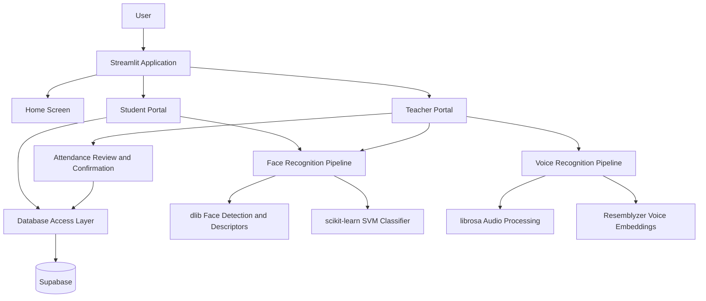

# AttendIQ — AI-Powered Smart Attendance System

**Smarter Attendance. Powered by AI.**

AttendIQ is a Streamlit-based classroom attendance application that combines face recognition and voice-based identification with student and teacher portals. It supports student registration, subject management, enrollment, classroom attendance review, and attendance records backed by Supabase.

> **Project status:** This README describes the functionality visible in the project files shared so far. Recognition quality, deployment readiness, and production security should be validated before real-world use.

## Table of Contents

- [Overview](#overview)
- [Features](#features)
- [Technology Stack](#technology-stack)
- [System Architecture](#system-architecture)
- [Project Structure](#project-structure)
- [How It Works](#how-it-works)
- [Getting Started](#getting-started)
- [Supabase Configuration](#supabase-configuration)
- [Database Tables](#database-tables)
- [Security and Privacy](#security-and-privacy)
- [Current Limitations](#current-limitations)
- [Future Enhancements](#future-enhancements)
- [Screenshots](#screenshots)
- [Project Information](#project-information)

## Overview

Traditional classroom attendance can take time and require manual record keeping. AttendIQ explores an AI-assisted workflow for identifying students and managing attendance records through a single web application.

The application has separate student and teacher experiences. Students can register using a camera capture, access their enrolled subjects, and view attendance counts. Teachers can register or log in, create and manage subjects, capture or upload classroom photos for face analysis, use the voice-attendance workflow, review attendance results before saving, and view attendance records.

## Features

### Student Portal

- Register a student profile using a camera capture.
- Generate a facial embedding for a registered student.
- Optionally record a short voice sample during registration.
- Sign in through face recognition.
- Enroll in a subject using a subject code or a shared join link.
- View enrolled subjects and attendance counts.
- Unenroll from a subject.

### Teacher Portal

- Register a teacher account and log in with a username and password.
- Create subjects using a subject code, name, and section.
- View subjects, enrolled-student counts, and class counts.
- Capture classroom photos using the camera or upload image files.
- Run face analysis on classroom photos.
- Review attendance results before confirming and saving them.
- Record attendance using the voice-attendance workflow.
- View attendance records grouped into class sessions.
- Share subject enrollment details using a generated QR code and join link.

### AI and Data Processing

- **Face Pipeline:** Uses dlib face detection and 128-dimensional face descriptors, with a scikit-learn SVM classifier and a distance threshold in the matching workflow.
- **Voice Pipeline:** Uses Resemblyzer voice embeddings and librosa audio loading/segmentation to compare audio segments with stored student voice embeddings.
- **Attendance Review:** Presents detected attendance results for teacher confirmation before saving.
- **Database Integration:** Uses Supabase tables for student, teacher, subject, enrollment, and attendance data.

## Technology Stack

| Area | Technologies |
|---|---|
| Programming Language | Python |
| Web Application | Streamlit |
| Face Detection and Embeddings | dlib, face_recognition_models |
| Classification | scikit-learn (SVC) |
| Numerical Processing | NumPy |
| Tabular Data | pandas |
| Image Handling | Pillow |
| Audio Processing | librosa |
| Voice Embeddings | Resemblyzer |
| Database Client | Supabase Python Client |
| Password Hashing | bcrypt |
| QR Code Generation | Segno |
| Version Control | Git and GitHub |

## System Architecture



The diagram is a high-level representation of the modules found in the supplied code. It does not imply that recognition is guaranteed to be accurate or that every deployment has identical configuration.

## Project Structure

```text
AttendIQ/
├── app.py
├── requirements.txt
├── .streamlit/
│   └── secrets.toml          # Local secrets; do not commit
└── src/
    ├── components/
    │   ├── dialog_add_photo.py
    │   ├── dialog_attendance_results.py
    │   ├── dialog_auto_enroll.py
    │   ├── dialog_create_subject.py
    │   ├── dialog_enroll.py
    │   ├── dialog_share_subject.py
    │   ├── dialog_voice_attendance.py
    │   ├── footer.py
    │   ├── header.py
    │   └── subject_card.py
    ├── database/
    │   ├── config.py
    │   └── db.py
    ├── pipelines/
    │   ├── face_pipeline.py
    │   └── voice_pipeline.py
    ├── screens/
    │   ├── home_screen.py
    │   ├── student_screen.py
    │   └── teacher_screen.py
    └── ui/
        └── base_layout.py
```

This tree reflects the files shared for review; additional files may exist in the full repository.

## How It Works

### 1. Face-Based Student Identification

1. A student captures an image through the Streamlit camera input.
2. The face pipeline detects faces and computes a 128-dimensional face descriptor using dlib.
3. The application obtains stored student embeddings and fits an SVM classifier.
4. The current matching workflow compares a descriptor against a stored embedding using a configured distance threshold.
5. A recognized student is signed in; an unrecognized face can proceed to the registration flow.

### 2. Teacher Face-Attendance Workflow

1. The teacher selects a subject.
2. The teacher captures classroom photos or uploads image files.
3. AttendIQ runs face analysis on the supplied photos.
4. Detected student IDs are compared with the students enrolled in the selected subject.
5. The application prepares a present/absent review table.
6. The teacher can discard the result or confirm and save the attendance records.

### 3. Voice-Attendance Workflow

1. The teacher selects a subject and records classroom audio.
2. AttendIQ retrieves enrolled students who have stored voice embeddings.
3. The voice pipeline loads and segments the audio, skips very short segments, and generates embeddings.
4. Each segment is compared with stored candidate embeddings using a similarity threshold.
5. The application prepares an attendance review table for the teacher to confirm before saving.

Voice recognition is threshold-based and should be tested carefully with realistic classroom recordings, background noise, overlapping speech, and varied microphones.

## Getting Started

### Prerequisites

- Python compatible with the installed dependencies.
- Git.
- A Supabase project with the tables and columns expected by the application.
- A camera for face registration and photo capture.
- A microphone for voice enrollment and voice attendance.

Some face-recognition dependencies may require additional system libraries or a compatible Python version. Installation can vary by operating system and Python release.

### 1. Clone the Repository

```bash
git clone https://github.com/Smith-dcunha/AttendIQ-main.git
cd AttendIQ-main
```

If the repository URL or repository name changes, use the current GitHub clone URL instead.

### 2. Create and Activate a Virtual Environment

**macOS / Linux**

```bash
python3 -m venv .venv
source .venv/bin/activate
```

**Windows PowerShell**

```powershell
py -m venv .venv
.\.venv\Scripts\Activate.ps1
```

### 3. Install Dependencies

```bash
python -m pip install --upgrade pip
pip install -r requirements.txt
```

If installation fails for dlib, `dlib-bin`, librosa, or Resemblyzer, check the package requirements for your operating system and Python version. Use a compatible environment rather than changing the Python version of unrelated projects.

### 4. Configure Supabase Secrets

The database configuration reads `SUPABASE_URL` and `SUPABASE_KEY` from Streamlit secrets.

For local development, create:

```text
.streamlit/secrets.toml
```

Add your own values using the keys expected by `src/database/config.py`:

```toml
SUPABASE_URL = "https://YOUR_PROJECT.supabase.co"
SUPABASE_KEY = "YOUR_SUPABASE_KEY"
```

Replace the placeholders locally.

**Never commit real credentials to GitHub.**

For deployment, configure the same keys in the hosting platform's secrets settings.

### 5. Run AttendIQ

```bash
streamlit run app.py
```

Streamlit will print a local URL, commonly `http://localhost:8501`, in the terminal.

## Database Tables

The supplied database code references these Supabase tables:

| Table | Purpose indicated by the code |
|---|---|
| `students` | Student names, IDs, face embeddings, and optional voice embeddings |
| `teachers` | Teacher usernames, names, and hashed passwords |
| `subjects` | Subject codes, names, sections, and teacher ownership |
| `subject_students` | Student-to-subject enrollment relationships |
| `attendance_logs` | Student attendance, subject, timestamp, and present/absent status |

The exact schema, constraints, indexes, foreign keys, and Row Level Security policies must be configured and verified in Supabase. They cannot be fully inferred from the client code alone.

## Security and Privacy

AttendIQ handles biometric embeddings and student attendance information. Before using it with real students:

- Obtain appropriate consent for biometric collection and processing.
- Keep Supabase credentials in secrets or environment configuration; never hardcode or commit them.
- Configure Supabase Row Level Security and least-privilege access policies for all relevant tables.
- Verify that students can access only their own permitted records and that teachers can access only authorized classes.
- Define secure retention and deletion procedures for biometric embeddings and attendance data.
- Use secure transport and restrict access to deployment logs and stored records.
- Test password handling, session behavior, registration abuse, and authorization boundaries.
- Evaluate false acceptance and false rejection rates before relying on face or voice matching for official attendance.

Password hashing with bcrypt is present in the teacher database functions, but hashing alone does not establish that the complete application is production-secure.

## Current Limitations

- Recognition performance depends on image quality, lighting, camera placement, audio quality, and the selected thresholds.
- Face and voice thresholds require validation against representative data.
- The current voice workflow uses segmented audio; overlapping speakers and classroom noise may reduce identification quality.
- The supplied files do not establish that liveness detection or anti-spoofing is implemented.
- The supplied files do not establish that automated tests, a formal evaluation dataset, or measured recognition accuracy are available.
- Supabase schema and access policies must be reviewed separately.
- A successful local run does not by itself confirm that cloud deployment and biometric processing will work in every environment.

## Future Enhancements

Possible future improvements include:

- Liveness detection and anti-spoofing checks.
- Formal evaluation of face and voice recognition with precision, recall, false-acceptance, and false-rejection metrics.
- More detailed attendance analytics and downloadable reports.
- Stronger authorization checks and audited access to student records.
- Better handling of noisy audio and overlapping speakers.
- Automated tests for enrollment, attendance saving, and role-specific access.
- Clear data-retention controls and a student-facing privacy notice.

These are suggestions for future work, not claims that the features are already implemented.

## Screenshots

Add genuine screenshots of the application to a repository folder such as `docs/screenshots/`, then embed them here.

Suggested screenshots:

- Home page with student and teacher portals.
- Student portal showing enrolled subjects.
- Teacher dashboard and subject management.
- Face-attendance review before confirmation.
- Voice-attendance review.
- QR-code subject sharing.

For example, after adding a screenshot at `docs/screenshots/home.png`:

```markdown

```

## Project Information

- **Project:** AttendIQ — AI-Powered Smart Attendance System
- **Domain:** Artificial Intelligence and Machine Learning
- **Interface:** Streamlit
- **Database:** Supabase
- **Developer:** Smith Dcunha

## License

No license was identified in the supplied files. Add a license only after deciding how you want others to use, modify, and distribute the project.

---

**AttendIQ — Smarter Attendance. Powered by AI.**
